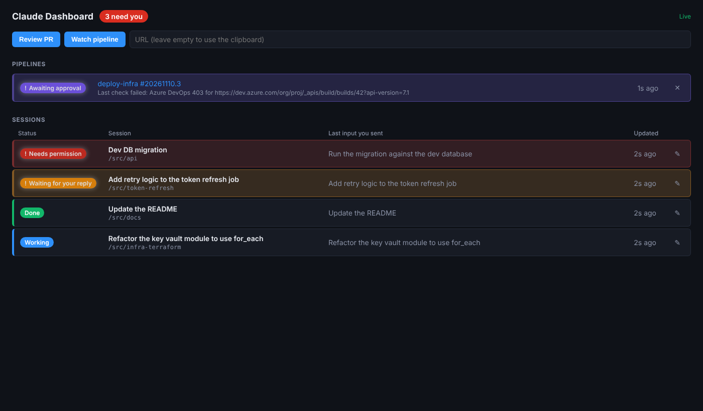

# claude-dashboard

A local dashboard for Claude Code sessions. It shows what you last sent each session, uses color to flag the ones
waiting on you, lets you rename sessions and drill into their notes, and has configurable buttons that act on the URL
in your clipboard (review a PR in a new session, watch a pipeline until it needs approval).



Stack: Bun server with SQLite and a WebSocket stream, Vue 3 client. The design follows the hooks -> HTTP -> SQLite ->
WebSocket -> UI approach of [disler/claude-code-hooks-multi-agent-observability](https://github.com/disler/claude-code-hooks-multi-agent-observability);
no code is taken from that project. Its event envelope (`POST /events`) is accepted as well as raw hook JSON.

## Setup on a new machine

Requires [Bun](https://bun.sh) and the `claude` CLI on PATH.

```sh
git clone git@github.com:loudbinary/claude-dashboard.git
cd claude-dashboard
bun run setup                               # install server and client dependencies
cp config.local.example.yaml config.local.yaml   # optional per-machine overrides
bun run build                               # build the client once
bun run start                               # http://127.0.0.1:4000
```

For development run `bun run server` and `bun run client` in two terminals and open http://localhost:5173.

### 1. Point it at your workspace

Sessions started from the dashboard run in `claude.default_cwd`. Set it to your workspace folder in `config.local.yaml`
(or set the `CLAUDE_DASHBOARD_CWD` environment variable) so they load that workspace's `CLAUDE.md`, `.claude` settings,
already-granted permissions, MCP servers and plugins, the same as a terminal session started there. The default (`.`)
is the dashboard's own folder, which has none of that; the server prints the folder it will use at startup.

```yaml
claude:
  default_cwd: C:/path/to/your/workspace
```

The dashboard does not override permissions unless you set `permission_mode` or `allowed_tools` in the config.

### 2. Send Claude Code events to the dashboard

Merge `hooks/settings.example.json` into `~/.claude/settings.json` (all projects) or a project's
`.claude/settings.json`. If you change `server.port`, change the URLs to match.

### 3. Set tokens

Tokens are read from environment variables named in `config.yaml`; they are never written to a file.

| Provider | Variable | Needs |
|---|---|---|
| Azure DevOps | `AZDO_PAT` | Build (Read) |
| GitHub | `GITHUB_TOKEN` | `actions:read` on the repos you watch |
| PagerDuty | `PAGERDUTY_TOKEN` | Read-only REST API key or user token |

## Configuration

`config.yaml` holds shared defaults and is checked in. `config.local.yaml` is git-ignored and deep-merged over it, so
each machine overrides only what differs (port, database path, working folder, which providers are enabled).
`CLAUDE_DASHBOARD_CONFIG` points at a different config file; `CLAUDE_DASHBOARD_PORT` overrides the port.

### Buttons

Buttons are entries under `actions:` in the config. No code change is needed to add one.

```yaml
actions:
  - key: review_pr          # unique id
    label: Review PR        # button text
    kind: session           # session = start a Claude session, watch = poll a pipeline run
    accepts: pr             # pr | run | incident: the kind of URL expected
    name: "PR review: {title}"
    prompt: "Review the pull request at {url}. ..."
    model:                  # empty = the CLI default; sonnet | opus | haiku | a model id
    permission_mode:        # empty = use the workspace's Claude settings
    allowed_tools: []       # e.g. ["Read", "Bash(gh pr:*)", "Bash(az repos:*)"]
    hidden: false           # true = no button, but still usable by key (the Teams sweep uses review_pr_teams this way)
```

A click reads the clipboard (the browser asks for permission once) or the URL box if you typed one. `{url}`, `{title}`
and `{provider}` are filled into `prompt` and `name`. `{details}` is filled with data the provider prefetches; for a
PagerDuty incident that is the incident, up to 10 alerts with their payloads, and its timeline, so the
"Analyze PagerDuty Incident" session starts with the alert content without needing PagerDuty access itself.
Recognized URLs:

| | Pull request | Pipeline run |
|---|---|---|
| Azure DevOps | `dev.azure.com/{org}/{project}/_git/{repo}/pullrequest/{id}` | `dev.azure.com/{org}/{project}/_build/results?buildId={id}` |
| GitHub | `github.com/{owner}/{repo}/pull/{n}` | `github.com/{owner}/{repo}/actions/runs/{id}` |

PagerDuty incidents: `{subdomain}.pagerduty.com/incidents/{id}` (any trailing path, such as `/timeline`).

Sessions started by a button run headless (`claude -p`), so they cannot stop to ask for permission. Give the review
action the tools it needs through `allowed_tools`; the session needs `gh` or `az` signed in to read a private PR.

`model:` picks the model for sessions that action starts (`claude --model <value>`). It is only passed when set, and it
wins over a `--model` in `claude.extra_args`. `review_pr` and `review_pr_teams` both have it, so PR reviews can use a
different model from everything else. It is unrelated to `teams_sweep.model`, which is only the cheap scanner below.

### Posting review comments to the pull request

Azure DevOps has no draft or pending comment state, so review drafts live in the dashboard and are posted only when
you click. The Claude review session never posts: `review_pr` and `review_pr_teams` forbid it, and the dashboard
server does the posting, using the existing `azure_devops` provider token (`token_env`). That token needs the
**Code (read & write)** scope.

- **Output format**: both review prompts end the final message with `## Summary`, a `Verdict: clean` or
  `Verdict: needs changes` line, a `## Draft comments` table, and a fenced block whose info string is `pr-comments`:
  `{"summary", "verdict", "comments": [{"file", "line", "end_line"?, "severity", "comment"}]}`. `file` is relative to
  the repository root with a leading slash; lines refer to the PR source (right) side. Severity is `blocker`,
  `major`, `minor` or `nit`.
- **Linking**: starting an action that accepts a PR URL records which PR the session reviews.
- **Parsing**: when a dashboard-started session finishes, the LAST `pr-comments` block is validated strictly (exact
  keys and types, at most 100 comments, comments clipped to 4000 characters) and stored as pending drafts. A missing or
  malformed block stores nothing and the session detail says "no structured drafts found". After a reply or resume,
  a new valid block replaces only the drafts still pending; posted and failed ones are kept.
- **Panel**: in the expanded session, "Draft comments (N)" shows the verdict, an editable summary with an
  "include summary" checkbox, and one row per draft (checkbox, `file:line`, severity, editable text, then the status
  or a link to the thread once posted). "Post selected" asks for confirmation with the count first.
- **Posting**: `POST /api/sessions/:id/drafts/post` with `{items: [{idx, comment}], include_summary?, summary?}`.
  It re-checks the PR is still active (refused when completed or abandoned), posts each selected pending or failed
  draft as a file thread (the summary as a general thread) with your edited text, and reports partial failures; failed
  ones can be retried and posted ones are never reposted. Every attempt is recorded in the session's events as
  `PrCommentsPosted` (PR URL, idx list, thread ids, failures, timestamp). `GET /api/sessions/:id/drafts` returns
  the drafts.
- **Footer**: `pr_comments.footer` in `config.yaml` is appended (after a blank line) to every posted comment,
  including the summary. Set it to an empty string to disable it.

### Teams PR sweep

The dashboard can watch Teams chats and channels for Azure DevOps pull request links and start a PR review session
for each PR that still needs review. It is off by default (`teams_sweep.enabled: false` in `config.yaml`). Turn it on
in `config.local.yaml`:

```yaml
teams_sweep:
  enabled: true
  me: you@example.com          # your Azure DevOps sign-in; PRs you already voted on are skipped
  sources:
    - { name: Dev Team, url: "https://teams.microsoft.com/l/chat/..." }
    - { name: Platform, url: "https://teams.microsoft.com/l/channel/.../General?groupId=..." }
```

How it works:

- Every `interval_seconds` (default 300), inside `active_hours` (default Mon-Fri 07:00-19:00 America/New_York, days
  numbered 1 = Monday to 7 = Sunday), the server runs one headless `claude -p --model <teams_sweep.model>` that reads
  the sources through the claude.ai Microsoft 365 connector. It only fetches raw messages. The server itself finds the
  PR links (regex, then the Azure DevOps URL parser), so the model never decides what is a PR.
- The first sweep per source only sets the starting point: no backfill. Message ids already handled are remembered,
  so an edited message does not trigger a second review, and each PR is launched at most once.
- A PR needs review when it is active, not a draft, nobody has approved it (vote 5 or more), and `me` has not voted.
  Your own PRs count. The Azure DevOps token needs Code (read).
- A PR that needs review starts the `teams_sweep.action` session (default `review_pr_teams`), at most
  `max_concurrent_reviews` at a time; the rest wait for the next sweep. Sessions show up like any other and trigger the
  normal toast when they wait for you.
- The header shows "Teams sweep: <time> ..." (red when the last scan failed). `GET /api/sweep` has the detail,
  including the decision for each PR (`launched`, `approved`, `closed`, `draft`, `voted`, `pending`).

Rules worth knowing:

- Review sessions never post comments or vote. The prompt says so; you post and vote yourself.
- The scanner runs with `--settings '{"disableAllHooks":true}'`. Without that, the workspace SessionStart hook would
  announce every scan to peer sessions and add a row to the dashboard.
- Peer announcements: sessions started by an action (Review PR, the Teams sweep's reviews, Investigate pipeline,
  Analyze PagerDuty Incident) launch with `CLAUDE_DASHBOARD_QUIET=1` in their environment. A workspace SessionStart
  hook can test it and skip messaging peer sessions, for example
  `[ "$CLAUDE_DASHBOARD_QUIET" = "1" ] && exit 0`. New session, resume and reply launch without it, so they still
  announce. Set `announce: true` on an action that edits files or moves branches.
- Cost: about $0.03 per scan with Haiku, so roughly $4 per day at 5 minutes in business hours. Sources that have not
  been seen yet are initialised without a scan.
- v1 scans top-level channel messages only, not replies. A PR link that the preview cuts off in the middle of the
  number is ignored. Links must be `dev.azure.com` or `*.visualstudio.com`.
- Roll back by setting `teams_sweep.enabled: false` and restarting. The two tables it adds are harmless.

Dry run: `bun run sweep:dry` (optionally `-- --hours 48`) runs one real scan over the last 24 hours and prints the PRs
it found with the review decision for each. It launches nothing and writes no state. It does cost one scan.

### Windows toasts

`notifications.scenario` controls how long a toast stays up: `reminder` (default) keeps it on screen until you click
it, `urgent` does the same and also breaks through Do Not Disturb, `default` lets it slide into the notification
centre. Reminder and urgent toasts carry an "Acknowledge" button because Windows quietly turns a reminder into a
normal toast unless it has a button with a background activation.

### Stale browser tabs

`GET /api/config` returns `client_build`, a hash of the built `apps/client/dist/index.html`. The page checks it every
minute and when the window gains focus, and shows a "new dashboard version is available" banner with a Reload button
after you rebuild the client.

### Status colors

Set under `ui.status`. States with `attention: true` sort to the top, tint the row and pulse.

| State | Default | Set when |
|---|---|---|
| Needs permission | red | Notification hook, `permission_prompt` |
| Waiting for your reply | amber | Stop hook, or Notification `idle_prompt` |
| Awaiting approval | purple | a watched run has a stage or environment waiting for approval |
| Failed | dark red | a watched run failed, or a launched session errored |
| Working / Watching | blue | prompt submitted or tool running; run in progress |
| Done / Succeeded | green | session ended; run succeeded |
| Inactive / Canceled | gray | no events for `ui.inactive_after_minutes`; run canceled |

## How it behaves

- **New session**: starts a Claude CLI session (`claude -p`) in the folder you choose. Start sessions here rather than
  in a terminal and every one of them can be followed and answered from the dashboard. They run headless, so they
  cannot stop to ask for permission: what the workspace's Claude settings already allow works, anything else is
  denied. `claude.new_session` in the config can widen that.
- **Resume session**: asks for a session name or id and continues it with `claude -p --resume`. Names of sessions
  already in the dashboard are matched first; any other value is passed to the Claude CLI, which accepts a session id
  or the session's own title. A resumed terminal session becomes answerable from the dashboard. Close it in the
  terminal first so two processes are not writing to the same session.
- **Seen**: a session or pipeline that needs you is vivid (and pulses) until you have seen it. Opening a session, clicking
  a pipeline row, the ✓ button, dismissing its popup, or "Mark all seen" marks it seen. A seen item stays at the top
  of the list in the muted `ui.seen_color` with a ✓ on its chip, the header count turns muted when nothing new is
  left, and no popup (in the page or a Windows toast) is raised for it again, including after a page refresh or a
  server restart. A toast already on screen is withdrawn. It becomes vivid again, with a new popup, only when its
  state changes, for example Claude finishes another turn and is waiting on you again.
  Popups for pipelines stay until you dismiss them; dismissing one marks the pipeline seen.
- **Rename**: click the pencil or edit the title in the detail panel. Names are stored in the dashboard database only.
- **Right-click a session row**: Rename, Mark seen, Stop session (a dashboard-started session that is still
  working), or Remove from dashboard.
- **Remove**: stops the Claude process (and its child processes) if the dashboard started it and it is still running,
  deletes the dashboard record, and remembers the removal: later hook events, streamed output and cross-session
  messages for that session are ignored, so it does not come back. A terminal session keeps running in its terminal.
  The transcript on disk is untouched, and Resume brings a removed session back.
- **Reply**: sessions started from the dashboard can be answered in the detail panel (resumed by session id).
  Sessions running in a terminal are observed only; reply in the terminal.
- **Session notes**: read from the transcript file Claude Code reports, so they appear only on the machine that ran the session.
- **Pipeline watch**: polled every `watch.poll_interval_seconds`; stops when the run finishes. Nothing is approved for you.
- **Local only**: the server binds to 127.0.0.1 and refuses POSTs from web pages on other origins. If you bind it elsewhere and open the UI by another name, list that origin under `server.allowed_origins` in config.local.yaml (`host`, `host:port` or `http(s)://host:port`; `*` is refused). Loopback is always allowed.

## Layout

```
config.yaml                 shared settings, buttons, colors
hooks/settings.example.json Claude Code hook config
apps/server/src/            app.ts (routes) state.ts (status rules) db.ts launcher.ts drafts.ts (review drafts) watcher.ts providers/
apps/server/test/           bun test
apps/client/src/            App.vue, components/, api.ts
```

## Status of this scaffold

Covered by tests (`bun run test`): config merge, status rules, URL parsing, approval detection against sample API
responses, routes, rename, reply rules, origin checks. The launcher has been run against the real `claude` CLI for
start, stream parsing, failure handling and resume, but only on a machine where the CLI was not signed in, so a
successful reply has not been seen yet. Not yet exercised against live systems: the HTTP hooks coming from a real
Claude Code session, and live Azure DevOps and GitHub API calls.
